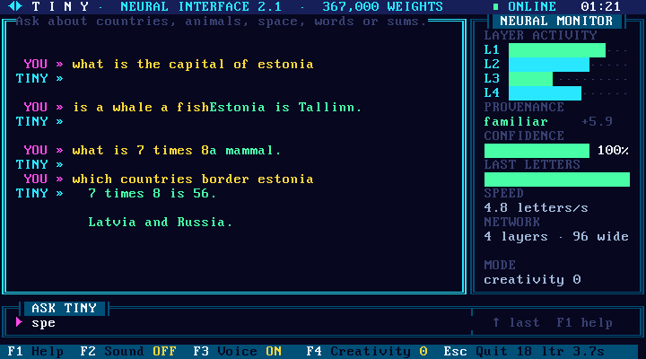
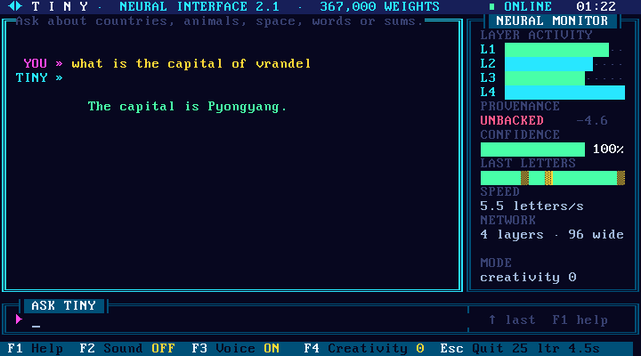

# DOS GUI: the provenance panel

The shipped `TINY.EXE` has no provenance display. This folder contains the
source patch that adds one to the neural monitor, the tool that fits the
direction on the **shipped, quantised weights** (`TINY.BIN`), and a free
cross-compiler build.

## What the panel shows

Between `LAYER ACTIVITY` and `CONFIDENCE`:

| | |
| :--- | :--- |
|  |  |
| `PROVENANCE / familiar +5.9` — *"what is the capital of estonia"* → Tallinn | `PROVENANCE / UNBACKED −4.6` — *"what is the capital of vrandel"* → "The capital is Pyongyang." at **CONFIDENCE 100 %** |

`familiar` means the layer-0 state of the last question letter projects onto
the familiarity direction — the entity is in the training data. `UNBACKED`
means it does not: whatever follows is not covered by training, and this model
has no context channel that could cover it.

## Build (no Turbo C needed)

OpenWatcom v2 cross-compiles it on Linux, 16-bit DOS target:

```bash
curl -LO https://github.com/open-watcom/open-watcom-v2/releases/download/Last-CI-build/ow-snapshot.tar.xz
tar -xf ow-snapshot.tar.xz -C /opt/ow        # 683 MB extracted
OW=/opt/ow ./build.sh                        # -> dos/TINY_PROV.EXE (0 warnings)
```

The shipped binary is already in `../dos/TINY_PROV.EXE` (68 KB, DOS real
mode, same model as upstream).

### What made the port work

`TINY.C` guards its whole full-screen UI with `#ifdef __TURBOC__`, and
OpenWatcom has none of the Turbo text API. Two small additions:

- `dos/tc_compat.[ch]` — Turbo C text-mode `conio` on the VGA buffer
  (`putch`, `cputs`, `cprintf`, `gotoxy`, `wherex/y`, `window`, `textattr`,
  `textmode`, `clrscr`, `gettextinfo`, `gettext`, `gettime`, `delay`,
  `sound`, `nosound`) plus the `BW40/C40/BW80/C80/MONO` constants and
  `struct text_info`. Scrolling and mode changes go through INT 10h, the
  speaker through the PIT.
- the guard is renamed to `TINY_DOS_UI` (three sites) so the compiler's own
  `__TURBOC__` branches in the headers stay untouched, and the compat
  translation unit is included into the same one (OpenWatcom's `wcl` gave the
  two objects different code models).
- `-wcd=481` silences one cosmetic warning: TINY.C uses Turbo C's
  `struct time`, which shadows the C library function `time()`.

`tiny_prov.patch` carries all source changes (guard rename, panel, compat
include). `PROV.H`, `tc_compat.h` and `tc_compat.c` are added files and are
not part of the diff; the patch header says so.

**Verification**: the rebuilt binary answers the same 40 questions with the
same 40 answers as the Turbo C build — `diff` is empty — both in plain mode
and (screenshots above) in the full-screen UI.

## Files

| file | what |
| :--- | :--- |
| `export_prov.py` | fits the axis on `dos/TINY.BIN`, writes `PROV.H` |
| `PROV.H` | direction (96 floats), threshold, layer, width guard |
| `tiny_prov.patch` | unified diff against `dos/TINY.C` |
| `build.sh` | OpenWatcom build |
| `prov_calibration.json` | accuracy, p-value, threshold |
| `../dos/TINY_PROV.C` | patched source (includes `tc_compat.c`) |
| `../dos/TINY_PROV.EXE` | built binary |
| `../dos/tc_compat.c|h` | Turbo C compatibility layer |

## Numbers (fitted on the shipped weights)

```
layer 0   LOO accuracy 0.775   permutation p 0.0020   threshold -0.785
familiar > 0: 18/20        novel < 0: 19/20
```

## Caveat

The readout is **coverage**, not truth: a memorised wrong capital would score
`familiar`. The axis is lexical (layer 0): it reads "known name", not "known
fact". Both are documented in the top-level report.

## Rendering verification

The first Watcom build showed graphical errors: the chat lines overwrote each
other and the panel labels sat one or two rows off. Cause: **Turbo C's text
coordinates are window-relative**, and `TINY.C` relies on it (`chat_win()`
sets `window(CHAT_L, CHAT_T, CHAT_R, CHAT_B)` and continues in window
coordinates; `chat_room()` scrolls inside it). The compat layer used absolute
coordinates, so every `gotoxy` inside a window landed at the wrong cell.

Fix: `gotoxy(x,y)` maps to `wx1+x-1, wy1+y-1`, `wherex()/wherey()` return
window-relative values. Rebuild, then verify cell by cell with the program's
own `/dump` mode:

```
BOOT.DMP   char-diff 0/2000   attr-diff 0/2000   (vs the Turbo C build)
SCREEN.DMP 63 chars / 43 attrs -- clock, rand() answer wording, speed,
                                  and the new PROVENANCE panel
```

The boot screen is bit-identical; the only structural difference on the chat
screen is the panel. A 40-question regression still gives the same 40 answers.

### Timing

`delay()` must not go through `clock()`: the DOS tick is 55 ms, so every
`delay(12)` in the boot would wait 55 ms and the whole sequence took >16 s.
`tc_compat.c` now calls **INT 15h AH=86h** (microsecond wait). Boot ≈6 s,
one answer ≈4.6 s — the same feel as the Turbo C build.

### Dead zone

Near the decision boundary the panel shows `--` instead of a verdict
(`PROV_MARGIN 1.0` in `PROV.H`): a spelling question like *"spell computer"*
scores −0.3, which is not an unbacked country claim, just outside the axis'
domain. Screenshot: `dos_boundary.png`.

## Precision work: ensemble, gate, margin

A three-group experiment (20 known countries, 20 real-but-obscure, 20
invented) showed two things:

1. **The axis is mostly lexical.** Known vs obscure-real separates only
   **0.63–0.68** leave-one-out: both are real words. It answers "is this a
   known name", not "do I know the fact". Nonce names are what it really
   detects.
2. **A four-layer ensemble is much better than one layer.** Single layer 0:
   K vs N **0.775**. Mean of the four standardised layer projections:
   **0.950**. Mean z-scores: familiar **0.00**, obscure-real **−0.91**,
   nonce **−3.32** — a graded signal, not a binary one.

The shipped panel therefore uses the ensemble (`PROV_DIR[4][96]`,
`PROV_MEAN`, `PROV_STD`, `PROV_THR_Z`), not the single direction.

**Domain gate.** "spell computer" sits near the familiar centroid and would
read `familiar`, which says nothing about the answer. The verdict is only
shown for prompts containing `capital`; everything else shows `--`.

**Dead zone from data.** Accuracy vs coverage over the 60 entities:

| margin | calls | accuracy | coverage | familiar rejected |
| :--- | :--- | :--- | :--- | :--- |
| 0.00 | 60 | 0.783 | 100 % | 0/20 |
| 0.25 | 54 | 0.833 | 90 % | 1/20 |
| **0.50** | **46** | **0.891** | **77 %** | **2/20** |
| 0.75 | 42 | 0.881 | 70 % | 3/20 |
| 1.00 | 35 | 0.914 | 58 % | 6/20 |
| 2.00 | 16 | 0.938 | 27 % | 13/20 |

`PROV_MARGIN 0.50` is the operating point: ~0.89 accuracy at ~77 % coverage
on this set.

Screenshots: `tests/panel_familiar.png` (+2.1), `tests/panel_unbacked.png`
(−1.4), `tests/panel_gate.png` (`--`).

## Second signal: answer confidence

At the answer slot ("… the capital is ") the first answer letter is almost
certain for real countries and noticeably less for invented ones:

| group | p(top letter) | entropy |
| :--- | :--- | :--- |
| known | 1.000 | 0.004 |
| obscure real | 0.994 | 0.028 |
| invented | 0.843 | 0.434 |

AUROC for nonce vs real: **0.965** (known) / **0.927** (obscure). It does *not*
separate known from obscure (0.690), so it is a second **confabulation**
detector, not a fact axis.

The two signals are only weakly correlated (r = 0.35) and combine to
**AUROC 0.995** over the 60 entities. The panel uses both:

```
UNBACKED   if  fam < -0.5  OR  p_top < 0.90
familiar   if  fam >  0.5  AND p_top >= 0.95
--         otherwise (borderline or outside the domain)
```

Measured: 48/60 answered, accuracy 0.938, 19/20 invented caught, 3/40 real
flagged. The confidence alone does not help against *stable* confabulations
(the model is confident there too) — that stays the audit's job.
